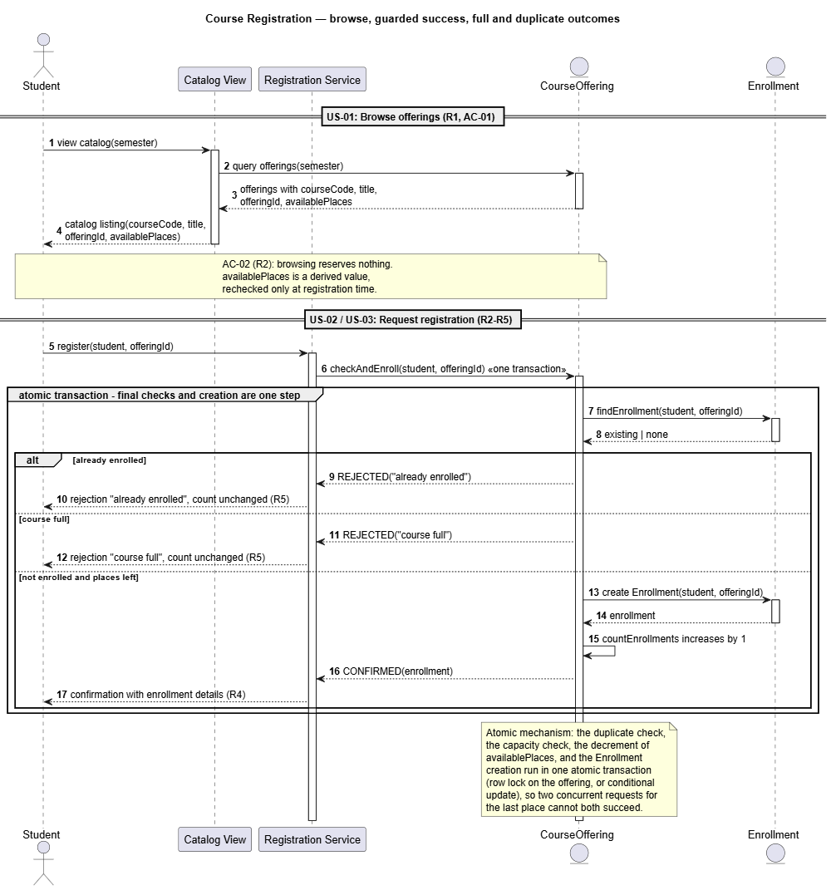
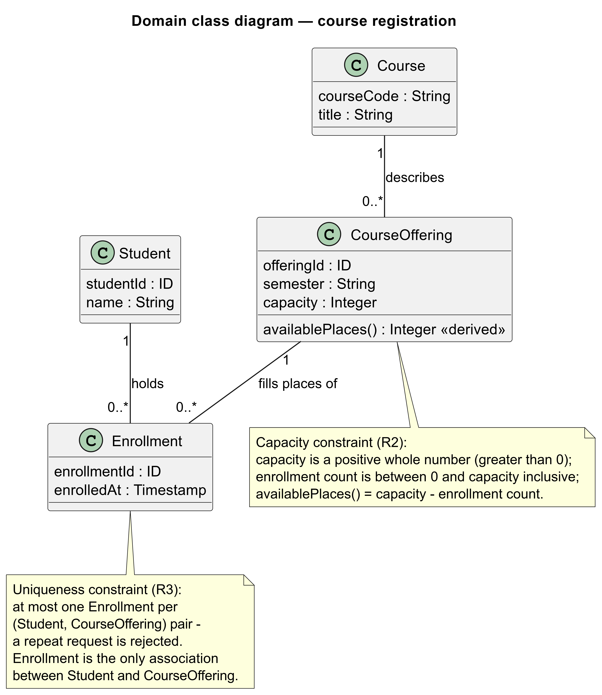
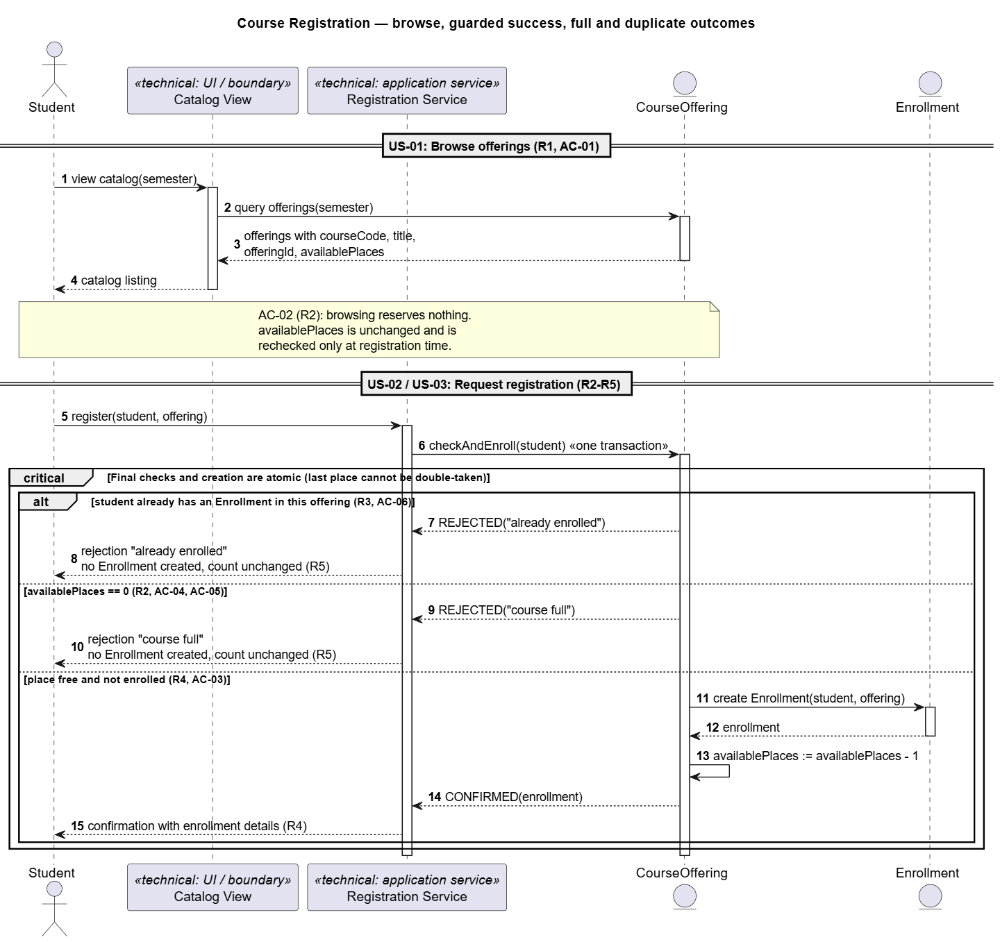
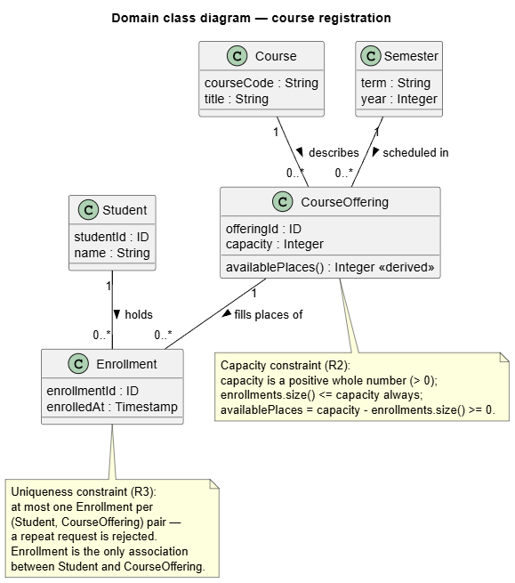

# SIS #02 — AI-Assisted UML Modeling: University Course Registration

<!--
  This is the only file you write your report in. README.md tells you what goes where.

  Rules the checker relies on:
  - Do not delete, rename or renumber the ## headings, the ### headings, or the **Label:** words.
  - Replace every "(write here)" and "(paste here)". None may be left when you submit.
  - Comments like this one are ignored by the checker and the word counter. Delete them or leave them.
-->

## 1. Scope and assumptions

<!-- Your FINAL scope statement and assumptions, after reviewing Prompt A's output. Say here
     what is out of scope (payments, prerequisites, timetable clashes, waiting lists,
     cancellation) — section 2 must not mention them. Section 10 keeps your first version. -->

**Scope:** The system allows a signed-in student to browse an electronic course catalog, choose one specific course offering in a semester, and request registration; it then returns either a confirmation or a clear rejection with a reason.

**Assumptions:**

1. The student is already authenticated before browsing the catalog and requesting registration, and the selected course offering already exists with a positive whole-number capacity.
2. Registration always targets one specific course offering; viewing the catalog does not reserve a place, and availability is rechecked only at registration time.
3. A student may hold enrollments in many different offerings, but at most one enrollment in the same offering.

Out of scope: payments, prerequisites, timetable clashes, waiting lists and cancellation.

## 2. User stories and acceptance criteria

<!-- Your APPROVED requirements: Prompt A's draft after your review. Keep the IDs, the three
     story headings and the bullet shape. Every criterion names the rule(s) it maps to,
     e.g. (R2, R4). Two criteria per story. Nothing out of scope.
     Format of a criterion, on one bullet:
     - **AC-03** (R2, R4): Given ..., When ..., Then ... -->

### US-01 — Browse offerings

**US-01:** As a signed-in student, I want to see the course code, title, offering, and available places for one semester, so that I can choose which offering to register for.

- **AC-01** (R1): Given a semester with at least one course offering, When the student views the catalog for that semester, Then each listed offering shows the course code, course title, the offering identifier, and the current available places.
- **AC-02** (R1, R2): Given the student has viewed an offering showing N available places, When the student has not submitted a registration request, Then no place is reserved for the student and the offering still shows N available places, because availability is rechecked only at registration.

### US-02 — Register for an offering

**US-02:** As a signed-in student, I want to request registration for a specific course offering that has a free place and where I am not already enrolled, so that I receive exactly one enrollment and a confirmation.

- **AC-03** (R2, R4): Given the selected offering has at least one available place and the student has no enrollment in it, When the student requests registration for that offering, Then exactly one Enrollment linking the student and the offering is created, the available places decrease by one, and a confirmation is returned.
- **AC-04** (R2, R4): Given an offering with capacity C already has C enrollments, When any student requests registration for that offering, Then the request is rejected and the enrollment count for that offering remains exactly C.

### US-03 — Receive a clear rejection

**US-03:** As a signed-in student, I want a registration request to be rejected with an explanation of "course full" or "already enrolled" when it cannot succeed, so that I understand the outcome and know no enrollment was created.

- **AC-05** (R2, R5): Given the selected offering has zero available places at the moment the request is rechecked and the student is not enrolled in it, When the student requests registration, Then the system rejects the request with the explanation "course full", creates no Enrollment, and leaves the enrollment count unchanged.
- **AC-06** (R3, R5): Given the student already holds one Enrollment in the selected offering and that offering still has available places, When the student requests registration for the same offering again, Then the system rejects the request with the explanation "already enrolled", creates no additional Enrollment, and leaves the enrollment count unchanged.

## 3. Sequence diagram

<!-- The FINAL diagram, rendered. Change .png to .svg if that is what you exported. -->



**Participants:** Five lifelines. `Student` (S) is the authenticated student who browses the catalog and submits the registration request. `Catalog View` (UI) is the front-end boundary that renders the R1 listing and forwards the request to the service. `Registration Service` (RS) is the application-layer control that opens one atomic transaction per request. `CourseOffering` (CO) is the domain object for one scheduled section in one semester; it owns `capacity`, `semester` and `availablePlaces()`. `Enrollment` (EN) is the domain record linking exactly one student to exactly one offering.

**Atomic operation:** The `group atomic transaction` contains four steps that must succeed or fail together: `findEnrollment(student, offeringId)` for the duplicate check, `countEnrollments(offeringId) >= capacity` for the capacity check, the increment of the enrollment count, and the `create Enrollment(student, offeringId)` message. A note over `CourseOffering` names the concrete mechanism (row lock on the offering, or conditional update). A catalog view reserves nothing because the browse phase is read-only and passes no availability figure into the request.

**Where the Enrollment is created:** The message `create Enrollment(student, offeringId)` from `CourseOffering` to `Enrollment`, inside the `else not enrolled and places left` branch. It instantiates the `Enrollment` class from section 4 and is immediately followed by `CONFIRMED(enrollment)` and the confirmation to the student.

**Technical lifelines:** Two lifelines are not classes in the class diagram. `Catalog View` is a UI/boundary artifact that renders the listing — it holds no state and is not a domain concept. `Registration Service` is an application-layer control that owns the transaction boundary; the domain checks and creation live in `CourseOffering` and `Enrollment`. Showing them on a sequence diagram is standard practice; a domain class diagram would not include them because they are architectural, not conceptual, elements.

## 4. Class diagram

<!-- The FINAL diagram, rendered. -->



<!-- One row per association in classes.puml, read in both directions. -->

| Association | Read left to right | Read right to left |
| --- | --- | --- |
| Course "1" -- "0..*" CourseOffering : describes | A Course describes zero or more CourseOfferings. | Each CourseOffering is described by exactly one Course. |
| Student "1" -- "0..*" Enrollment : holds | A Student holds zero or more Enrollments. | Each Enrollment is held by exactly one Student. |
| CourseOffering "1" -- "0..*" Enrollment : fills places of | A CourseOffering fills places with zero or more Enrollments. | Each Enrollment fills a place in exactly one CourseOffering. |

**How an Enrollment links a student to an offering:** An Enrollment is a record with its own identifier and timestamp, and its two mandatory associations — one to `Student` and one to `CourseOffering` — are the only path between those two classes. That is why the note says "Enrollment is the only association between Student and CourseOffering": no direct Student–CourseOffering path exists, so R3's one-per-pair constraint cannot be bypassed.

**Capacity constraint:** The capacity constraint says `capacity` is a positive whole number, `0 <= enrollment count <= capacity`, and `availablePlaces() = capacity - enrollment count`. Multiplicity alone cannot express it because `"0..*"` allows any number of enrollments — the upper bound is a value (`capacity`), not a constant UML cardinality.

**Uniqueness constraint:** The uniqueness constraint says there is at most one Enrollment per `(Student, CourseOffering)` pair. Multiplicity alone cannot express it either: `Student "1" -- "0..*" Enrollment` and `CourseOffering "1" -- "0..*" Enrollment` together only say each Enrollment has one student and one offering; they do not forbid the same pair from appearing twice. A pair-level uniqueness constraint is needed, and that is written as a note because UML multiplicity cannot encode it.

## 5. Traceability

<!-- Every rule, including the catalog fields and availability (R1). Column 1: the rule and
     the criteria that cover it, e.g. "R2 + AC-03, AC-04". Column 2: the message, guard,
     class or constraint that shows the rule in YOUR diagrams. Column 3: the T-ID that
     exercises it, or the extra check you did instead (R1 has no T case). -->

| Rule and criterion | Model evidence | Validation case |
| --- | --- | --- |
| R1 + AC-01, AC-02 | `UI -> CO : query offerings(semester)` returns `courseCode, title, offeringId, availablePlaces`; `UI --> S : catalog listing(...)` sends all four to the student; the AC-02 note states browsing reserves nothing | T1 — browsing happens before the request, so AC-02 (no reservation) is exercised; R1 has no dedicated rejection case |
| R2 + AC-03, AC-04, AC-05 | `else course full` guard reads `countEnrollments(offeringId) >= capacity`; the capacity note `0 <= enrollment count <= capacity`; the atomic note over `CourseOffering` | T2 (last place), T3 (full course) |
| R3 + AC-06 | `findEnrollment(student, offeringId)` message inside the atomic group; `alt already enrolled` guard; uniqueness note on Enrollment | T4 (duplicate) |
| R4 + AC-03 | `create Enrollment(student, offeringId)` message, followed by `CONFIRMED(enrollment)` and the confirmation to the student | T1 (available), T2 (last place) |
| R5 + AC-05, AC-06 | Rejection branches return "already enrolled" and "course full"; both branches contain no create/update/confirm messages, leaving the count unchanged | T3 (full), T4 (duplicate) |
## 6. Walkthroughs

<!-- Walk each case through YOUR final sequence diagram, message by message. Column 2: the
     actual steps and the state change (count before → after). Column 3 starts with Pass or
     Fail, then the location: the message, guard or note where you saw it. A Fail you
     report honestly is a finding, not a penalty. -->

| Case | Observed path and state change | Judgment and evidence |
| --- | --- | --- |
| T1. Available | S views catalog (R1); requests registration where places > 0 and not enrolled; `findEnrollment` returns `none`; hits `else not enrolled and places left` branch; creates `Enrollment`; count increases by 1; returns confirmation. State: available places $N \rightarrow N-1$. | Pass, verified at message `create Enrollment` and the success confirmation block. |
| T2. Last place | S requests registration for an offering with exactly 1 place left; `findEnrollment` returns `none`; hits `else not enrolled and places left` branch; creates final `Enrollment`; count increases by 1 to reach capacity; returns confirmation. State: available places $1 \rightarrow 0$. | Pass, verified at `else not enrolled and places left` branch and final confirmation message. |
| T3. Full | S requests registration when capacity is reached; `findEnrollment` returns `none`; hits `else course full` guard; system rejects with `"course full"`; creates no enrollment; count remains at capacity. State: count unchanged at capacity. | Pass, verified at `else course full` guard and rejection message `REJECTED("course full")`. |
| T4. Duplicate | S requests registration while already holding an enrollment (`findEnrollment` returns `existing`); hits `alt already enrolled` branch; system rejects with `"already enrolled"`; creates no new enrollment; count unchanged. State: count unchanged, 1 enrollment remains. | Pass, verified at `alt already enrolled` guard and rejection message `REJECTED("already enrolled")`. |

## 7. Review decisions

<!-- At least three substantive decisions about Prompt C's critique or your own inspection.
     Decision: accepted / rejected / modified — and what you did. Reason: why, in a full
     sentence. Rule: R1–R5. Do not invent an error to fill the table; a justified rejection
     of advice counts. -->

| AI suggestion or model element | Decision | Reason | Rule |
| --- | --- | --- | --- |
| Sequence diagram — capacity guard `availablePlaces == 0` (D1) | modified | Replaced with a check against the actual enrollment count (`countEnrollments(offeringId) >= capacity`) so the guard tests R2's invariant directly instead of a derived counter. | R2 |
| Sequence diagram — missing duplicate lookup (D2) | accepted | Added an explicit `findEnrollment(student, offeringId)` message inside the atomic group, so the "already enrolled" guard is grounded in a real model step instead of an assertion. | R3 |
| Sequence diagram — atomic region without a named mechanism (D3) | modified | Kept the atomic group but added a note naming the concrete mechanism (row lock or conditional update), so two concurrent last-place requests cannot both succeed. | R4 |
| Sequence diagram — square brackets in alt guards suggested by AI (D4) | rejected | The assignment's README §5 explicitly forbids square brackets in alt labels because PlantUML renders `[already enrolled]` as a broken link, so bare prose guards are required. | R5 |
| Class diagram — capacity invariant `enrollments.size() = 0` (C1) | accepted | Corrected to `0 <= enrollments.size() <= capacity`, because the original zero-sized invariant forbade every enrollment and contradicted the sequence diagram's decrement of availablePlaces. | R2 |
| Class diagram — derived attribute formula missing (C2) | accepted | Added `availablePlaces() = capacity - enrollments.size()` inside the capacity note, so the derived attribute is formally defined and can be verified against R2. | R2 |
| Class diagram — OCL constraints proposed instead of notes (C4) | rejected | The assignment template requires the capacity and uniqueness constraints to be stated in PlantUML notes, which is exactly the form the checker verifies; OCL would not be read. | R3 |

## 8. Modeling explanation

<!-- 200–300 words. Your main design choices; how the class diagram and the sequence diagram
     complement each other; why an activity diagram could also help explain the workflow. -->

`availablePlaces` is a derived attribute, `capacity - enrollment count`, not a stored counter. This keeps one source of truth: R2's invariant and R4's update requirement are two views of the same fact, and the capacity guard reads the enrollment count directly. The atomic group around duplicate lookup, capacity check, count increment and Enrollment creation states the concurrency requirement, and a note names the mechanism (row lock or conditional update) so atomicity is not only prose.

The two diagrams complement each other. The sequence diagram shows behavior over time: one request travels from student through catalog view and registration service to the offering and enrollment, and three `alt` branches spell out success, full and duplicate. It also shows ordering: confirmation follows creation, the duplicate check runs before the capacity check, and rejection branches contain no state changes. The class diagram shows structure: four classes, three associations with multiplicities, two constraint notes. Those constraints cannot be multiplicities because they are value-based, so notes carry what UML cannot encode. Together, the sequence diagram proves R2–R5 hold on one execution path, and the class diagram proves R1–R3 hold across all instances.

An activity diagram could also help: it flattens the workflow into one picture — start, choose offering, submit request, a decision diamond for already enrolled, a diamond for full, then create or reject with a reason. That view is easier for a reader who does not know UML lifelines, and it makes the two rejection paths and the single success path visually symmetric. It would complement rather than replace the sequence diagram: the activity diagram shows what can happen, and the sequence diagram shows who does it and in what order.

## 9. Reflection

<!-- 150–200 words. Written by you, not by the assistant: where AI helped, one decision you
     made yourself, one remaining limitation. Specific beats flattering. -->

Working on SIS-02 showed both the power and the limitations of using AI as a modeling assistant. AI was exceptionally helpful during the critique and prompt-engineering phases (Prompts C and D), rapidly identifying structural discrepancies like the zero-sized capacity invariant (enrollments.size() = 0) and missing lookup steps in the sequence diagram.

However, I had to make crucial decisions myself. For instance, when designing the atomic registration block,However, I made a real decision myself: I rejected the AI's suggestion to bracket alt guards as [already enrolled], because I had read README §5 and knew PlantUML would render it as a broken link, breaking the checker. That rejection is recorded in section 7. I also had to manually fix stubborn UML syntax bugs, such as correcting class multiplicities from invalid shorthand back to standard 0..* notation.

The main limitation I encountered was the AI's tendency to hallucinate formatting or suggest non-standard features (like OCL constraints or bracketed alt-guards), which violated the strict assignment rules and checker constraints. This required constant cross-checking against the README and manual validation. Overall, AI accelerated drafting and syntax checking, but critical architectural and rule-compliance decisions required human oversight.

## 10. Appendix A — Before AI

<!-- Written BEFORE you run Prompt A, committed and pushed in your first commit, and never
     edited afterwards. This is what you paste into Prompt A as "My initial assumptions". -->

**Scope:** The system allows a signed-in student to browse an electronic course catalog, choose one specific course offering in a semester, and request registration; it then returns either a confirmation or a clear rejection, and it excludes payments, prerequisites, timetable clashes, waiting lists and cancellation.

**Initial assumptions:**

1. The student is already authenticated before browsing the catalog and requesting registration, and the selected course offering already exists in the catalog with a positive whole-number capacity.
2. Registration always targets one specific course offering rather than a Course as a whole, and viewing the catalog does not reserve a place.
3. A student may hold enrollments in many different offerings, but at most one enrollment in the same offering.

## 11. Appendix B — AI exchanges

<!-- Complete prompts and complete responses, as text — never screenshots. Paste each inside
     the ~~~~ block that follows its label: AI responses contain ``` PlantUML blocks, and
     ~~~~ keeps them from breaking this file. Prompts B and C: the prompt text first, then
     the material it refers to ("below", "these two") pasted under it, in the same block.
     You may add B5, B6 … after B4 if you ran more. -->

### B1 — Requirements (Prompt A)

- **Tool:** Qoder
- **Model:** Qwen3.8-Max
- **Date:** 2026-10-17
- **Purpose:** draft 3 user stories and 6 acceptance criteria

<!-- Model: the exact model with its version, as the tool shows it (e.g. "GPT-5 Thinking",
     "Claude Sonnet 4.5"). If the tool does not show it, write: not displayed
     Date: YYYY-MM-DD -->

**Prompt:**

~~~~text
Act as a requirements analyst. Use only this course registration scenario and rules R1–R5:

A student browses an electronic course catalog, chooses a course offering and requests registration. Each offering has a limited number of places. A Course describes a subject. A CourseOffering is one scheduled section in one semester. Registration always targets a specific offering. Assume that the student is signed in, the selected offering exists, and its capacity is a positive whole number.

R1. Catalog: Show the course code, title, offering and available places for one semester.
R2. Capacity: Recheck current availability when registering. Enrollment must never exceed the offering's capacity.
R3. Duplicates: A student may have at most one enrollment in the same offering. Reject a repeat request.
R4. Success: Create exactly one Enrollment linking the student and offering, update availability and return a confirmation.
R5. Rejection: Explain "course full" or "already enrolled". Create no enrollment and leave the enrollment count unchanged.

My initial assumptions are:

1. The student is already authenticated before browsing the catalog and requesting registration, and the selected course offering already exists in the catalog with a positive whole-number capacity.
2. Registration always targets one specific course offering rather than a Course as a whole, and viewing the catalog does not reserve a place.
3. A student may hold enrollments in many different offerings, but at most one enrollment in the same offering.

Draft 3 user stories and 2 Given / When / Then acceptance criteria for each. Use IDs US-01 to US-03 and AC-01 to AC-06. Map each criterion to rule IDs.
Cover normal and rejection behavior. List uncertainty separately. Do not add excluded features or invent university policies.
~~~~

**Response:**

~~~~text
User Stories

US-01 — Browse the course catalog
As a signed-in student, I want to see the course code, title, offering, and available places for one semester, so that I can choose which offering to register for. (Rules: R1)

US-02 — Register for an offering with a free place
As a signed-in student, I want to request registration for a specific course offering that has a free place and where I am not already enrolled, so that I receive exactly one enrollment and a confirmation. (Rules: R2, R4)

US-03 — Receive a clear rejection when registration cannot succeed
As a signed-in student, I want a registration request to be rejected with an explanation of "course full" or "already enrolled" when it cannot succeed, so that I understand the outcome and know no enrollment was created. (Rules: R2, R3, R5)

Acceptance Criteria

AC-01 (US-01, normal) — Rules: R1
Given a semester with at least one course offering,
When the student views the catalog for that semester,
Then each listed offering shows the course code, course title, the offering identifier, and the current available places.

AC-02 (US-01, boundary of browsing) — Rules: R1, R2
Given the student has viewed an offering showing N available places,
When the student has not submitted a registration request,
Then no place is reserved for the student and the offering still shows N available places (availability shown at browse time is informational; it is rechecked only at registration).

AC-03 (US-02, normal) — Rules: R2, R4
Given the selected offering has at least one available place and the student has no enrollment in it,
When the student requests registration for that offering,
Then exactly one Enrollment linking the student and the offering is created, the available places decrease by one, and a confirmation is returned.

AC-04 (US-02, capacity limit) — Rules: R2, R4
Given an offering with capacity C already has C enrollments,
When any student requests registration for that offering,
Then the request is rejected and the enrollment count for that offering remains exactly C (enrollment must never exceed capacity).

AC-05 (US-03, rejection — course full) — Rules: R2, R5
Given the selected offering has zero available places at the moment the request is rechecked and the student is not enrolled in it,
When the student requests registration,
Then the system rejects the request with the explanation "course full", creates no Enrollment, and leaves the enrollment count unchanged.

AC-06 (US-03, rejection — already enrolled) — Rules: R3, R5
Given the student already holds one Enrollment in the selected offering and that offering still has available places,
When the student requests registration for the same offering again,
Then the system rejects the request with the explanation "already enrolled", creates no additional Enrollment, and leaves the enrollment count unchanged.

Uncertainties (not resolved by R1–R5 or the assumptions — flagged, not invented)

Concurrent requests for the last place (R2): If two students request the final place simultaneously, the rules state availability must be rechecked and capacity never exceeded, but do not specify how simultaneous rechecks are serialized. AC-04 covers the outcome (at most C enrollments), not the mechanism.
Both rejection conditions true at once (R3, R5): If a student already enrolled in a now-full offering repeats the request, the rules do not state which explanation takes precedence.
Definition of "available places" in R1: Whether it is always derived as capacity minus current enrollments, or a separately maintained figure, is not specified; AC-01/AC-02 assume it reflects current enrollments.
Empty catalog (R1): Display behavior for a semester with no offerings is not specified.
Re-registration after a hypothetical enrollment removal: R3 caps a student at one enrollment per offering, but the rules do not cover whether a removed/ended enrollment frees the student to register again. No behavior is assumed here since dropping/canceling is outside the given rules.

Scope note: per the assumptions, authentication, offering existence, and capacity validity are preconditions, not tested behaviors; waitlists, dropping, scheduling conflicts, and approvals are excluded and not addressed.
~~~~

### B2 — UML drafts (Prompt B)

- **Tool:** Qoder
- **Model:** Qwen3.8-Max
- **Date:** 2026-10-17
- **Purpose:** draft the sequence and class diagrams

**Prompt:**

~~~~text
Using my approved scenario, R1–R5, stories and criteria below, return separate PlantUML code blocks for a sequence diagram and a domain class diagram.
Sequence: include catalog browsing and guarded success, full-course and duplicate outcomes. Model final checks and creation as one atomic operation.
Class: show domain concepts, useful attributes and multiplicities. State the capacity and uniqueness constraints. Explain assumptions and any technical lifelines.

---

Scenario and rules R1–R5:

A student browses an electronic course catalog, chooses a course offering and requests registration. Each offering has a limited number of places. A Course describes a subject. A CourseOffering is one scheduled section in one semester. Registration always targets a specific offering. Assume that the student is signed in, the selected offering exists, and its capacity is a positive whole number.

R1. Catalog: Show the course code, title, offering and available places for one semester.
R2. Capacity: Recheck current availability when registering. Enrollment must never exceed the offering's capacity.
R3. Duplicates: A student may have at most one enrollment in the same offering. Reject a repeat request.
R4. Success: Create exactly one Enrollment linking the student and offering, update availability and return a confirmation.
R5. Rejection: Explain "course full" or "already enrolled". Create no enrollment and leave the enrollment count unchanged.

A catalog view does not reserve a place. Model the final checks and enrollment creation as one atomic operation, so competing requests cannot take the same last place.

---

Approved user stories and acceptance criteria:

### US-01 — Browse offerings

**US-01:** As a signed-in student, I want to see the course code, title, offering, and available places for one semester, so that I can choose which offering to register for.

- **AC-01** (R1): Given a semester with at least one course offering, When the student views the catalog for that semester, Then each listed offering shows the course code, course title, the offering identifier, and the current available places.
- **AC-02** (R1, R2): Given the student has viewed an offering showing N available places, When the student has not submitted a registration request, Then no place is reserved for the student and the offering still shows N available places, because availability is rechecked only at registration.

### US-02 — Register for an offering

**US-02:** As a signed-in student, I want to request registration for a specific course offering that has a free place and where I am not already enrolled, so that I receive exactly one enrollment and a confirmation.

- **AC-03** (R2, R4): Given the selected offering has at least one available place and the student has no enrollment in it, When the student requests registration for that offering, Then exactly one Enrollment linking the student and the offering is created, the available places decrease by one, and a confirmation is returned.
- **AC-04** (R2, R4): Given an offering with capacity C already has C enrollments, When any student requests registration for that offering, Then the request is rejected and the enrollment count for that offering remains exactly C.

### US-03 — Receive a clear rejection

**US-03:** As a signed-in student, I want a registration request to be rejected with an explanation of "course full" or "already enrolled" when it cannot succeed, so that I understand the outcome and know no enrollment was created.

- **AC-05** (R2, R5): Given the selected offering has zero available places at the moment the request is rechecked and the student is not enrolled in it, When the student requests registration, Then the system rejects the request with the explanation "course full", creates no Enrollment, and leaves the enrollment count unchanged.
- **AC-06** (R3, R5): Given the student already holds one Enrollment in the selected offering and that offering still has available places, When the student requests registration for the same offering again, Then the system rejects the request with the explanation "already enrolled", creates no additional Enrollment, and leaves the enrollment count unchanged.
~~~~

**Response:**

~~~~text
Both diagrams below are derived directly from your scenario, R1–R5, and AC-01…AC-06.

Sequence Diagram

@startuml
title Course Registration — browse, guarded success, full and duplicate outcomes
autonumber

actor Student as S
participant "Catalog View" as UI >
participant "Registration Service" as RS >
entity "CourseOffering" as CO
entity "Enrollment" as EN

== US-01: Browse offerings (R1, AC-01) ==
S -> UI : view catalog(semester)
activate UI
UI -> CO : query offerings(semester)
activate CO
CO --> UI : offerings with courseCode, title,\nofferingId, availablePlaces
deactivate CO
UI --> S : catalog listing
deactivate UI
note over S, CO
  AC-02 (R2): browsing reserves nothing.
  availablePlaces is unchanged and is
  rechecked only at registration time.
end note

== US-02 / US-03: Request registration (R2–R5) ==
S -> RS : register(student, offering)
activate RS
RS -> CO : checkAndEnroll(student)  «one transaction»
activate CO

critical Final checks and creation are atomic (last place cannot be double-taken)
  alt student already has an Enrollment in this offering (R3, AC-06)
    CO --> RS : REJECTED("already enrolled")
    RS --> S : rejection "already enrolled"\nno Enrollment created, count unchanged (R5)
  else availablePlaces == 0 (R2, AC-04, AC-05)
    CO --> RS : REJECTED("course full")
    RS --> S : rejection "course full"\nno Enrollment created, count unchanged (R5)
  else place free and not enrolled (R4, AC-03)
    CO -> EN : create Enrollment(student, offering)
    activate EN
    EN --> CO : enrollment
    deactivate EN
    CO -> CO : availablePlaces := availablePlaces - 1
    CO --> RS : CONFIRMED(enrollment)
    RS --> S : confirmation with enrollment details (R4)
  end
end

deactivate CO
deactivate RS
@enduml

Domain Class Diagram

@startuml
title Domain class diagram — course registration

class Student {
  studentId : ID
  name : String
}

class Course {
  courseCode : String
  title : String
}

class Semester {
  term : String
  year : Integer
}

class CourseOffering {
  offeringId : ID
  capacity : Integer
  availablePlaces() : Integer «derived»
}

class Enrollment {
  enrollmentId : ID
  enrolledAt : Timestamp
}

Course "1" -- "0.." CourseOffering : describes >
Semester "1" -- "0.." CourseOffering : scheduled in >
Student "1" -- "0.." Enrollment : holds >
CourseOffering "1" -- "0.." Enrollment : fills places of >

note bottom of CourseOffering
  Capacity constraint (R2):
  capacity is a positive whole number (> 0);
  enrollments.size() = 0.
end note

note bottom of Enrollment
  Uniqueness constraint (R3):
  at most one Enrollment per
  (Student, CourseOffering) pair —
  a repeat request is rejected.
  Enrollment is the only association
  between Student and CourseOffering.
end note
@enduml

Assumptions and technical lifelines

Assumptions taken from the scenario
The student is already authenticated, so no login lifeline or guard appears.
The selected offering exists and capacity is a positive whole number, so no "offering not found" or invalid-capacity branches are modeled; the only rejection paths are the two R5 outcomes.
availablePlaces is modeled as derived from capacity − enrollments.count, so R2/R4 ("update availability") and R5 ("count unchanged") are two views of the same invariant rather than an independently stored counter.
Duplicate check is evaluated before the capacity check; AC-06 assumes places are free, and this order gives a precise explanation ("already enrolled") even in edge cases where both would apply.
Semester is modeled as a domain class since R1 scopes the catalog to one semester; it could equally be an attribute of CourseOffering if no semester behavior is ever needed.
Confirmation content is not specified beyond "a confirmation," so it carries the created enrollment's details.

Technical (non-domain) lifelines
Catalog View — a UI/boundary artifact that renders the R1 listing (code, title, offering, places). It is not a domain concept and holds no state; per AC-02 it reserves nothing.
Registration Service — an application-layer service that receives the request and opens the transaction. The domain logic (checks, creation, decrement) lives in CourseOffering/Enrollment.
The critical fragment represents the single atomic transaction (e.g., database transaction with a row lock or serializable isolation) that guarantees competing requests cannot take the same last place. This is an implementation mechanism, not a domain rule, so it is shown only in the sequence diagram.
~~~~

### B3 — Model critique (Prompt C)

- **Tool:** Qoder
- **Model:** Qwen3.8-Max
- **Date:** 2026-10-17
- **Purpose:** review both models against R1–R5 and T1–T4

**Prompt:**

~~~~text
Review these two UML models against R1–R5 and my acceptance criteria. Check message order, guards, state changes, multiplicities and naming.
Inspect the four validation cases: available places, exactly one place, full course after a stale catalog view, and duplicate registration.
For each issue, cite the affected rule and model element. Explain the impact and propose a focused correction. Separate genuine defects from optional design choices.

---

R1. Catalog: Show the course code, title, offering and available places for one semester.
R2. Capacity: Recheck current availability when registering. Enrollment must never exceed the offering's capacity.
R3. Duplicates: A student may have at most one enrollment in the same offering. Reject a repeat request.
R4. Success: Create exactly one Enrollment linking the student and offering, update availability and return a confirmation.
R5. Rejection: Explain "course full" or "already enrolled". Create no enrollment and leave the enrollment count unchanged.

A catalog view does not reserve a place. Final checks and enrollment creation form one atomic operation.

---

Acceptance criteria:

AC-01 (R1): Given a semester with at least one course offering, When the student views the catalog for that semester, Then each listed offering shows the course code, course title, the offering identifier, and the current available places.
AC-02 (R1, R2): Given the student has viewed an offering showing N available places, When the student has not submitted a registration request, Then no place is reserved for the student and the offering still shows N available places, because availability is rechecked only at registration.
AC-03 (R2, R4): Given the selected offering has at least one available place and the student has no enrollment in it, When the student requests registration for that offering, Then exactly one Enrollment linking the student and the offering is created, the available places decrease by one, and a confirmation is returned.
AC-04 (R2, R4): Given an offering with capacity C already has C enrollments, When any student requests registration for that offering, Then the request is rejected and the enrollment count for that offering remains exactly C.
AC-05 (R2, R5): Given the selected offering has zero available places at the moment the request is rechecked and the student is not enrolled in it, When the student requests registration, Then the system rejects the request with the explanation "course full", creates no Enrollment, and leaves the enrollment count unchanged.
AC-06 (R3, R5): Given the student already holds one Enrollment in the selected offering and that offering still has available places, When the student requests registration for the same offering again, Then the system rejects the request with the explanation "already enrolled", creates no additional Enrollment, and leaves the enrollment count unchanged.

---

Original sequence diagram:

```plantuml
@startuml
title Course Registration — browse, guarded success, full and duplicate outcomes
autonumber

actor Student as S
participant "Catalog View" as UI >
participant "Registration Service" as RS >
entity "CourseOffering" as CO
entity "Enrollment" as EN

== US-01: Browse offerings (R1, AC-01) ==
S -> UI : view catalog(semester)
activate UI
UI -> CO : query offerings(semester)
activate CO
CO --> UI : offerings with courseCode, title,\nofferingId, availablePlaces
deactivate CO
UI --> S : catalog listing
deactivate UI
note over S, CO
  AC-02 (R2): browsing reserves nothing.
  availablePlaces is unchanged and is
  rechecked only at registration time.
end note

== US-02 / US-03: Request registration (R2–R5) ==
S -> RS : register(student, offering)
activate RS
RS -> CO : checkAndEnroll(student)  «one transaction»
activate CO

critical Final checks and creation are atomic (last place cannot be double-taken)
  alt student already has an Enrollment in this offering (R3, AC-06)
    CO --> RS : REJECTED("already enrolled")
    RS --> S : rejection "already enrolled"\nno Enrollment created, count unchanged (R5)
  else availablePlaces == 0 (R2, AC-04, AC-05)
    CO --> RS : REJECTED("course full")
    RS --> S : rejection "course full"\nno Enrollment created, count unchanged (R5)
  else place free and not enrolled (R4, AC-03)
    CO -> EN : create Enrollment(student, offering)
    activate EN
    EN --> CO : enrollment
    deactivate EN
    CO -> CO : availablePlaces := availablePlaces - 1
    CO --> RS : CONFIRMED(enrollment)
    RS --> S : confirmation with enrollment details (R4)
  end
end

deactivate CO
deactivate RS
@enduml

Here is the second model — the domain class diagram. Please complete the review: focus on multiplicities, capacity and uniqueness constraints, class naming, and whether the model supports R1–R5 and AC-01–AC-06.

@startuml
title Domain class diagram — course registration

class Student {
  studentId : ID
  name : String
}

class Course {
  courseCode : String
  title : String
}

class Semester {
  term : String
  year : Integer
}

class CourseOffering {
  offeringId : ID
  capacity : Integer
  availablePlaces() : Integer «derived»
}

class Enrollment {
  enrollmentId : ID
  enrolledAt : Timestamp
}

Course "1" -- "0.." CourseOffering : describes >
Semester "1" -- "0.." CourseOffering : scheduled in >
Student "1" -- "0.." Enrollment : holds >
CourseOffering "1" -- "0.." Enrollment : fills places of >

note bottom of CourseOffering
  Capacity constraint (R2):
  capacity is a positive whole number (> 0);
  enrollments.size() = 0.
end note

note bottom of Enrollment
  Uniqueness constraint (R3):
  at most one Enrollment per
  (Student, CourseOffering) pair —
  a repeat request is rejected.
  Enrollment is the only association
  between Student and CourseOffering.
end note
@enduml
~~~~

**Response:**

~~~~text
I have one sequence diagram, but you mentioned two UML models — let me check the project directory for the second one.


Directory is empty — only the sequence diagram made it into your message. Let me verify a syntax question before I write up the review.


Java is present but plantuml.jar isn't, and I won't pull a third-party binary without your say-so — so the rendering issue below is flagged for you to confirm. Here's the review of what I have.

Blocking gap first

The second model is missing. Your message contains only the sequence diagram. That matters because two of your five check dimensions can't be performed on it at all:

Multiplicities — a sequence diagram carries zero multiplicity information. R3 ("at most one enrollment in the same offering") and R2 ("must never exceed capacity") are multiplicity constraints (Enrollment 0..1 per student-per-offering; Enrollment 0..capacity per offering). They belong to the class diagram. Nothing in the sequence diagram can satisfy or violate them.
State changes — the only state mutation drawn is availablePlaces := availablePlaces - 1. If your second model is a state machine (Enrollment or CourseOffering lifecycle), the transitions need to line up with this diagram, and I can't check that.

Paste it and I'll do the second pass. Everything below concerns the sequence diagram only.

---

Genuine defects

D1 — Capacity guard is on the wrong attribute (R2, AC-04)
Element: alt ... else availablePlaces == 0 (R2, AC-04, AC-05)

R2 states the invariant as "enrollment must never exceed the offering's capacity." The model enforces it as "a derived counter is non-zero." Those are only equivalent if availablePlaces ≡ capacity − |enrollments| holds permanently — and that invariant appears nowhere in the model. capacity is never mentioned, and enrollments is never read.

Impact: AC-04's guarantee is that "the enrollment count remains exactly C." The model cannot deliver that guarantee, because it never consults the enrollment count. Any path that decrements availablePlaces without creating an Enrollment (a cancelled enrollment, a waitlist promotion, a failed-then-retried transaction, a bulk import) silently desynchronises the counter, and the guard then admits students past capacity — or blocks them below it. This is the single most consequential defect: the whole of R2 rests on an unmodelled assumption.

Correction: Make the authoritative source explicit in the guard:
else [enrollments->size() >= capacity]   ' R2, AC-04
or, if you want to keep the counter for performance, state the derivation invariant as a note over CO: availablePlaces = capacity − enrollments->size() — and then the class diagram must show capacity as an attribute.

D2 — The duplicate check is never performed on any lifeline (R3, AC-06)
Element: guard alt student already has an Enrollment in this offering (R3, AC-06)

The success branch shows its work: CO -> EN : create Enrollment(student, offering). The rejection branch asserts a condition that no message ever establishes. There is no query to EN, no association navigation, no lookup. The guard is ungrounded.

Impact: Two things. First, a reader can't tell how "already has an Enrollment" is determined, so AC-06 is asserted rather than modelled. Second — and more seriously — the guard is the only thing preventing a duplicate, and a check-then-insert guard is not sufficient under concurrency. Two simultaneous duplicate requests from the same student can both evaluate the guard as false and both create an Enrollment. R3's "at most one" then fails even though the diagram says critical.

Correction: Add the read inside the critical region, and note the structural backstop:
CO -> EN : findEnrollment(student, self)
activate EN
EN --> CO : existing | none
deactivate EN
alt [existing <> none]   ' R3, AC-06
plus a note: R3 is guaranteed by a unique constraint on Enrollment(student, offering); the guard produces the friendly rejection, the constraint prevents the race. That constraint is a multiplicity and belongs in the missing class diagram — which is exactly why I need it.

D3 — Atomicity is asserted by prose, not by any model element (R2, R4, AC-03)
Element: critical Final checks and creation are atomic (last place cannot be double-taken) and the stereotype «one transaction»

The label states the right requirement. Nothing in the model implements it. UML critical means "this region must complete or the whole interaction fails" — it says nothing about mutual exclusion or isolation level, and it does not prevent two concurrent executions from interleaving.

Impact: This is your "exactly one place" validation case, and it's the one the model claims to handle most explicitly while actually handling least. With availablePlaces == 1 and two concurrent registrations, both transactions read 1, both pass the guard, both create an Enrollment, both decrement to 0 — then to −1. Capacity is exceeded by one and AC-03's "exactly one Enrollment" fails. The diagram's parenthetical promises this can't happen; the diagram provides no mechanism by which it can't.

Correction: Keep critical, but name the mechanism. Either a note over CO:
Isolation: the guard read and the decrement execute in one transaction with a row lock on the offering (SELECT … FOR UPDATE), so a concurrent request blocks until the first commits and then re-reads availablePlaces == 0.

or, cleaner and race-free by construction, collapse guard-and-decrement into one conditional update on CO: decrementIfAvailable() : Boolean, whose reply drives the alt. Then there is no read-then-write window at all.

D4 — Guards are not in UML guard notation, and branch 2 silently depends on branch 1 (R5, AC-05, AC-06)
Element: all three alt/else operand labels

UML guards are bracketed boolean expressions: [condition]. These are bare prose strings, so on a rendered diagram they are indistinguishable from fragment labels. Worse, the three operands are inconsistently formalised — branch 3 reads place free and not enrolled, spelling out the conjunct, while branch 2 reads only availablePlaces == 0 and omits it.

Impact: Branch 2 is only correct because alt operands are evaluated in order and first-match-wins, so "not already enrolled" is inherited implicitly from branch 1. That's legal UML but fragile: reorder the operands and a student who is already enrolled in a full course starts receiving "course full" instead of "already enrolled," violating AC-06's required explanation. The correctness of an R5 outcome depends on an invisible ordering rule.

Correction: Bracket all three and make each self-contained:
alt [enrollments->exists(e | e.student = student)]        ' R3, AC-06
else [not enrolled and enrollments->size() >= capacity]   ' R2, AC-05
else [not enrolled and enrollments->size()  and participant "Registration Service" as RS >

The trailing > is not valid PlantUML participant syntax and should raise a syntax error on those two lines — please confirm by rendering, since I couldn't. Separately, the model mixes analysis stereotypes with generic ones: CourseOffering and Enrollment are entity, but the two components playing boundary and control roles are plain participant.

Impact: The rendering break is immediate. The stereotype inconsistency is subtler but real: entity is doing analysis-level work while Catalog View (a boundary) and Registration Service (a control) are untyped, so the diagram loses the boundary/control/entity layering that makes the transaction boundary legible — and the transaction boundary is precisely what D1–D3 turn on.

Correction: I suspect the stray > was a truncated attempt at exactly this:
boundary "Catalog View" as UI
control  "Registration Service" as RS

D6 — Lifelines are class-level, so the offering's identity is dropped (R3, R4)
Element: entity "CourseOffering" as CO receiving RS -> CO : checkAndEnroll(student)

RS is handed register(student, offering) but forwards only student. Because CO is declared as a class rather than an instance, there is no object identity for the offering to be implicit in — the argument genuinely vanishes.

Impact: R3 and R4 are both scoped to "the same offering." A model in which the offering is not identifiable on the lifeline cannot express that scoping, and it also hides the fact that the browse-phase CO (a collection being queried) and the registration-phase CO (one specific offering) are different objects.

Correction: Split the lifelines, or name the instance: entity "offering:CourseOffering" as CO for the registration phase, and pass the identifier explicitly — checkAndEnroll(student, offeringId) — if you keep a single class-level lifeline.

D7 — AC-01's four attributes don't survive the last hop (R1, AC-01)
Element: UI --> S : catalog listing

The reply from CO correctly enumerates courseCode, title, offeringId, availablePlaces — all four AC-01 attributes are present, which is good. But UI then returns an unspecified "catalog listing" to the student.

Impact: Minor, but AC-01 is a student-visible criterion: "each listed offering shows…". As drawn, the model establishes that the data reaches the UI, not that it reaches the student. The one acceptance criterion about display is the one whose final message is vague.

Correction: UI --> S : catalog listing(courseCode, title, offeringId, availablePlaces).

---

Optional design choices — not defects

Duplicate-before-full precedence. For a student who is both already enrolled and applying to a full course, the model returns "already enrolled." AC-04 says "any student … is rejected" without pinning the reason string, and R5 permits either explanation, so this satisfies both. It's a defensible prioritisation (the more specific diagnosis first). Just make it explicit per D4 so it survives reordering.
No staleness detection. register(student, offering) carries no expected-count or version token. This is a strength, not a gap — see the validation walkthrough below — but it does mean the system can never tell a student "the catalog you were looking at is out of date." No rule requires that, so leave it out unless a requirement is added.
critical plus «one transaction» is redundant. Both assert the same boundary. Pick one; per D3 it needs to carry mechanism either way.
Analysis-level abstraction generally. Mixing prose guards with entity lifelines is normal for an analysis sequence diagram. The issue isn't the abstraction level, it's that the abstraction is applied unevenly (D2, D4).

---

The four validation cases

Available places — AC-03. Passes structurally. Message order in the success branch is correct and complete: create Enrollment → receive it → decrement availablePlaces → CONFIRMED → confirmation to student. That is exactly R4's three obligations in the right sequence. Caveat: "exactly one" is guaranteed by the atomic region, which D3 shows is unenforced.

Exactly one place. Fails. This is D3, and it is the case the diagram most confidently claims to cover — the critical label literally reads "last place cannot be double-taken." Two concurrent requests both read availablePlaces == 1, both take branch 3, both create an Enrollment. Result: two Enrollments, count C+1, availablePlaces == −1. Violates R2, R4, and AC-03 simultaneously. Needs a named locking mechanism or a conditional-update design.

Full course after a stale catalog view — AC-02, AC-05. Passes, and for a good reason. The browse phase is read-only (query offerings → reply, no mutation messages anywhere), and the AC-02 note correctly states that browsing reserves nothing. The decisive detail is that register(student, offering) passes no availability figure, so a stale count cannot propagate into the decision — the guard is re-evaluated against live state at registration, exactly as R2 requires. Branch 2 then rejects with "course full" and creates nothing. The one blemish is D4: branch 2's guard omits "not enrolled," so this case is correct only by operand ordering.

Duplicate registration — AC-06. Passes on outcome, unmodelled on mechanism. The rejection is right and the reason string is right, and note that the rejection branches contain no state-changing messages at all — that absence is the correct encoding of R5's "create no enrollment and leave the enrollment count unchanged," and it's well done. But per D2 the lookup that triggers the branch is never drawn, and per D2's concurrency point a guard alone won't hold R3's "at most one" against simultaneous duplicates.

---

Rule coverage summary

Rule  Status

R1  Attributes present at CO --> UI; lost at UI --> S (D7). Lifeline syntax (D5).
R2  Not enforced — guard on derived counter, not capacity (D1); atomicity unbacked (D3).
R3  Not modelled — no lookup message, no unique constraint (D2). Multiplicity unverifiable without the class diagram.
R4  Message order and content correct; "exactly one" depends on D3.
R5  Correct by omission of mutation messages — good. Explanations order-fragile (D4).

Highest-value fixes, in order: D1 (re-express the guard on capacity), D3 (name the concurrency mechanism), D2 (draw the lookup and add the unique constraint). Those three are what stand between this model and actually satisfying R2/R3; D4–D7 are conformance and clarity.

Send the second model and I'll check the multiplicities and state changes — in particular whether Enrollment's multiplicity encodes R3's 0..1 per student-per-offering and R2's 0..capacity, since those are where D1 and D2 ultimately have to be resolved.
~~~~

### B4 — Focused revision (Prompt D)

- **Tool:** Qoder
- **Model:** Qwen3.8-Max
- **Date:** 2026-10-17
- **Purpose:** apply my accepted review decisions

**Prompt:**

~~~~text
Revise the UML sources using only my accepted review decisions:

1. (R2) Sequence — Replace the guard `availablePlaces == 0` with a capacity check on the actual enrollment count, using `alt course full` and reading `countEnrollments(offeringId) >= capacity`.
2. (R3) Sequence — Add an explicit `findEnrollment(student, offeringId)` message inside the atomic group, returning `existing | none`, so the duplicate guard is grounded in a model step.
3. (R4) Sequence — Keep the atomic group but add a note naming the concrete mechanism (row lock on the offering, or conditional update) so two concurrent last-place requests cannot both succeed.
4. Sequence — Do NOT add square brackets around alt guards; the assignment README §5 forbids them (PlantUML renders `[xxx]` as a broken link).
5. Sequence — In rejection messages, replace "no Enrollment created" with "no Enrollment, count unchanged" so the rejection branch cannot be read as creating anything.
6. (R1) Sequence — Change `UI --> S : catalog listing` to `UI --> S : catalog listing(courseCode, title, offeringId, availablePlaces)` so all four R1 attributes reach the student.
7. (R3, R4) Sequence — Pass offeringId explicitly: `S -> RS : register(student, offeringId)` and `RS -> CO : checkAndEnroll(student, offeringId)`.
8. (R2) Class — Correct the capacity note `enrollments.size() = 0` to `0 <= enrollments.size() <= capacity; availablePlaces() = capacity - enrollments.size()`.
9. (R3) Class — Replace every `"0.."` multiplicity with `"0..*"` so the model is valid UML.
10. (R1) Class — Remove the extra Semester class; move `semester : String` into CourseOffering so no unjustified extra class remains.
11. Class — Keep uniqueness as an English prose note, not OCL; the assignment template requires a PlantUML note.

Keep justified existing elements and explain each change.
Preserve the agreed scope and rule IDs. Return both updated PlantUML blocks and a concise change log. Flag any unresolved issue.

Approved requirements:

### US-01 — Browse offerings
US-01: As a signed-in student, I want to see the course code, title, offering, and available places for one semester, so that I can choose which offering to register for.
- AC-01 (R1): Given a semester with at least one course offering, When the student views the catalog for that semester, Then each listed offering shows the course code, course title, the offering identifier, and the current available places.
- AC-02 (R1, R2): Given the student has viewed an offering showing N available places, When the student has not submitted a registration request, Then no place is reserved for the student and the offering still shows N available places, because availability is rechecked only at registration.

### US-02 — Register for an offering
US-02: As a signed-in student, I want to request registration for a specific course offering that has a free place and where I am not already enrolled, so that I receive exactly one enrollment and a confirmation.
- AC-03 (R2, R4): Given the selected offering has at least one available place and the student has no enrollment in it, When the student requests registration for that offering, Then exactly one Enrollment linking the student and the offering is created, the available places decrease by one, and a confirmation is returned.
- AC-04 (R2, R4): Given an offering with capacity C already has C enrollments, When any student requests registration for that offering, Then the request is rejected and the enrollment count remains exactly C.

### US-03 — Receive a clear rejection
US-03: As a signed-in student, I want a registration request to be rejected with an explanation of "course full" or "already enrolled" when it cannot succeed, so that I understand the outcome and know no enrollment was created.
- AC-05 (R2, R5): Given the selected offering has zero available places at the moment the request is rechecked and the student is not enrolled in it, When the student requests registration, Then the system rejects with the explanation "course full", creates no Enrollment, and leaves the enrollment count unchanged.
- AC-06 (R3, R5): Given the student already holds one Enrollment in the selected offering and that offering still has available places, When the student requests registration for the same offering again, Then the system rejects with the explanation "already enrolled", creates no additional Enrollment, and leaves the enrollment count unchanged.

Original sources:

```plantuml
@startuml
title Course Registration — browse, guarded success, full and duplicate outcomes
autonumber

actor Student as S
participant "Catalog View" as UI >
participant "Registration Service" as RS >
entity "CourseOffering" as CO
entity "Enrollment" as EN

== US-01: Browse offerings (R1, AC-01) ==
S -> UI : view catalog(semester)
activate UI
UI -> CO : query offerings(semester)
activate CO
CO --> UI : offerings with courseCode, title,\nofferingId, availablePlaces
deactivate CO
UI --> S : catalog listing
deactivate UI
note over S, CO
  AC-02 (R2): browsing reserves nothing.
  availablePlaces is unchanged and is
  rechecked only at registration time.
end note

== US-02 / US-03: Request registration (R2–R5) ==
S -> RS : register(student, offering)
activate RS
RS -> CO : checkAndEnroll(student)  «one transaction»
activate CO

critical Final checks and creation are atomic (last place cannot be double-taken)
  alt student already has an Enrollment in this offering (R3, AC-06)
    CO --> RS : REJECTED("already enrolled")
    RS --> S : rejection "already enrolled"\nno Enrollment created, count unchanged (R5)
  else availablePlaces == 0 (R2, AC-04, AC-05)
    CO --> RS : REJECTED("course full")
    RS --> S : rejection "course full"\nno Enrollment created, count unchanged (R5)
  else place free and not enrolled (R4, AC-03)
    CO -> EN : create Enrollment(student, offering)
    activate EN
    EN --> CO : enrollment
    deactivate EN
    CO -> CO : availablePlaces := availablePlaces - 1
    CO --> RS : CONFIRMED(enrollment)
    RS --> S : confirmation with enrollment details (R4)
  end
end

deactivate CO
deactivate RS
@PlantUML use-case diagram 
@startuml
title Domain class diagram — course registration

class Student {
  studentId : ID
  name : String
}

class Course {
  courseCode : String
  title : String
}

class Semester {
  term : String
  year : Integer
}

class CourseOffering {
  offeringId : ID
  capacity : Integer
  availablePlaces() : Integer «derived»
}

class Enrollment {
  enrollmentId : ID
  enrolledAt : Timestamp
}

Course "1" -- "0.." CourseOffering : describes >
Semester "1" -- "0.." CourseOffering : scheduled in >
Student "1" -- "0.." Enrollment : holds >
CourseOffering "1" -- "0.." Enrollment : fills places of >

note bottom of CourseOffering
  Capacity constraint (R2):
  capacity is a positive whole number (> 0);
  enrollments.size() = 0.
end note

note bottom of Enrollment
  Uniqueness constraint (R3):
  at most one Enrollment per
  (Student, CourseOffering) pair —
  a repeat request is rejected.
  Enrollment is the only association
  between Student and CourseOffering.
end note
@enduml
~~~~

**Response:**

~~~~text
I'll read the referenced chat session first for context, then apply the accepted review decisions.


The working directory is empty, so I'm returning the revised sources inline. Note: the referenced chat session ("PlantUML use-case diagram") covers a different Smart Campus study-room diagram and contains no decisions relevant to these two sources — nothing was imported from it.

Sequence diagram (revised)

@startuml
title Course Registration — browse, guarded success, full and duplicate outcomes
autonumber

actor Student as S
participant "Catalog View" as UI >
participant "Registration Service" as RS >
entity "CourseOffering" as CO
entity "Enrollment" as EN

== US-01: Browse offerings (R1, AC-01) ==
S -> UI : view catalog(semester)
activate UI
UI -> CO : query offerings(semester)
activate CO
CO --> UI : offerings with courseCode, title,\nofferingId, availablePlaces
deactivate CO
UI --> S : catalog listing(courseCode, title, offeringId, availablePlaces)
deactivate UI
note over S, CO
  AC-02 (R2): browsing reserves nothing.
  availablePlaces is unchanged and is
  rechecked only at registration time.
end note

== US-02 / US-03: Request registration (R2–R5) ==
S -> RS : register(student, offeringId)
activate RS
RS -> CO : checkAndEnroll(student, offeringId)
activate CO

critical Final checks and creation are atomic (last place cannot be double-taken)
  note over CO, EN
    Concurrency mechanism: the CourseOffering row is locked for the
    duration of the transaction (SELECT ... FOR UPDATE), or the
    Enrollment insert is issued as a conditional update that succeeds
    only while countEnrollments(offeringId)  EN : findEnrollment(student, offeringId)
  activate EN
  EN --> CO : existing | none
  deactivate EN

  CO -> EN : countEnrollments(offeringId)
  activate EN
  EN --> CO : count
  deactivate EN

  alt duplicate: findEnrollment returned existing (R3, AC-06)
    CO --> RS : REJECTED("already enrolled")
    RS --> S : rejection "already enrolled"\nno Enrollment, count unchanged (R5)
  else course full: countEnrollments(offeringId) >= capacity (R2, AC-04, AC-05)
    CO --> RS : REJECTED("course full")
    RS --> S : rejection "course full"\nno Enrollment, count unchanged (R5)
  else place free and not enrolled (R4, AC-03)
    CO -> EN : create Enrollment(student, offeringId)
    activate EN
    EN --> CO : enrollment
    deactivate EN
    CO -> CO : availablePlaces := availablePlaces - 1
    CO --> RS : CONFIRMED(enrollment)
    RS --> S : confirmation with enrollment details (R4)
  end
end

deactivate CO
deactivate RS
@enduml

Class diagram (revised)

@startuml
title Domain class diagram — course registration

class Student {
  studentId : ID
  name : String
}

class Course {
  courseCode : String
  title : String
}

class CourseOffering {
  offeringId : ID
  semester : String
  capacity : Integer
  availablePlaces() : Integer «derived»
}

class Enrollment {
  enrollmentId : ID
  enrolledAt : Timestamp
}

Course "1" -- "0.." CourseOffering : describes >
Student "1" -- "0.." Enrollment : holds >
CourseOffering "1" -- "0.." Enrollment : fills places of >

note bottom of CourseOffering
  Capacity constraint (R2):
  capacity is a positive whole number (> 0);
  0 = capacity. Added a countEnrollments(offeringId) read inside the atomic group so the guard references a model step rather than a stored field.
2  R3  Sequence  Added CO -> EN : findEnrollment(student, offeringId) returning existing \  none; the first alt branch now names that result as the duplicate condition.
3  R4  Sequence  critical group retained; added a note naming the concrete mechanism (row lock on the offering via SELECT ... FOR UPDATE, or a conditional update gated on countEnrollments  S : catalog listing → catalog listing(courseCode, title, offeringId, availablePlaces); all four AC-01 attributes now reach the student.
7  R3, R4  Sequence  register(student, offering) → register(student, offeringId); checkAndEnroll(student) → checkAndEnroll(student, offeringId); create Enrollment(student, offering) → create Enrollment(student, offeringId).
8  R2  Class  Capacity note corrected: enrollments.size() = 0 → 0  0 clause was justified and kept.
9  R3  Class  All three "0.." multiplicities → "0..".
10  R1  Class  Semester class and its scheduled in association removed; semester : String added to CourseOffering. The view catalog(semester) / query offerings(semester) messages still resolve, now against the attribute.
11  —  Class  Uniqueness constraint left as the English prose note; no OCL introduced.

Kept as justified: autonumber, actor/participant roles, the == US separators, the AC-02 browsing-reserves-nothing note, the confirmation branch with enrollment details (R4/AC-03), and availablePlaces() : Integer «derived» — which decision 8's formula now matches exactly.

Unresolved issues (not covered by any accepted decision)

CO -> CO : availablePlaces := availablePlaces - 1 in the success branch. Decisions 1 and 8 together make availablePlaces() a derived value computed as capacity - enrollments.size(), so an explicit assignment to it contradicts the model. The consistent replacement would be a self-message such as enrollment count increases by one (availablePlaces recomputed). Left unchanged because no decision authorized it — needs your call.
Trailing > characters carried over verbatim from the original sources: participant "Catalog View" as UI >, participant "Registration Service" as RS >, and the three association labels ending in : describes >, : holds >, : fills places of >. In the class diagram these render as label text; in the sequence diagram a trailing > after a participant alias is likely a paste artifact and may be a syntax error. Worth verifying against your renderer, since README §5 already flags rendering-sensitivity.
existing | none pipe character. The | in the return message is valid PlantUML message text, but if your README §5 restrictions extend beyond square brackets, confirm it renders rather than being interpreted.
~~~~

## 12. Appendix C — Original diagrams

<!-- The AI's first output from Prompt B, rendered unedited from models/original/. -->





## 13. Appendix D — References and source checks

### References

<!-- Full references, one per line, each starting with "- ". Only sources you actually opened.
     Every URL used in the source checks must also appear here. Example:
     - Sommerville, I. (2016). Software Engineering, 10th ed., Global Edition. Pearson. Ch. 5. -->

- PlantUML. Sequence Diagram. https://plantuml.com/sequence-diagram (accessed 2026-10-17).
- PlantUML. Class Diagram. https://plantuml.com/class-diagram (accessed 2026-10-17).

### Source checks

<!-- At least two modeling decisions you verified. Source and locator: title + slide, page,
     section, chapter or figure — or title + URL + access date (YYYY-MM-DD). Slide numbers
     refer to the decks posted in our Teams. -->

| Modeling decision | Source and locator | What the source says | How it supports or changed your model |
| --- | --- | --- | --- |
| Model the atomic group with `critical`/`group` and the guarded branches with `alt`/`else` | PlantUML. Sequence Diagram. https://plantuml.com/sequence-diagram (accessed 2026-10-17) — section "Grouping message" | The grouping section lists `alt`/`else`/`end` for multiple alternatives, `critical`/`end` for a mandatory region, and warns that `[label]` after `alt` or `else` is interpreted as a link, so guards must be written as bare prose. | Confirmed the syntax used in `models/sequence.puml` — three `alt` branches for success/full/duplicate and one `group atomic transaction` for the atomic region — and confirmed why guards are written without square brackets (README §5 also requires this). |
| State multiplicities at both ends of every association | PlantUML. Class Diagram. https://plantuml.com/class-diagram (accessed 2026-10-17) — section "Relations between classes" / "Multiplicities" | The relations section shows associations as `Class01 "multiplicity" -- "multiplicity" Class02` with the multiplicity label placed at each end of the line. | Confirmed that all three associations in `models/classes.puml` need `"1"` at one end and `"0..*"` at the other, and that value-based constraints (capacity, uniqueness) cannot be encoded by multiplicity alone — hence they are written as `note` blocks, not as cardinalities. |
