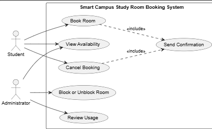

# Lab report — Practice #03, Requirements Engineering with AI

Fill in every section. **Do not delete or renumber the headings** — the README points at them and a
missing heading reads as a missing section.

Name: Tomiris Zhazykbayeva
Student ID: 24B031766
GitHub username: UtroAme

---

## 1. Setup

| | |
| --- | --- |
| AI assistant (tool) | Qoder|
| Exact model name and version | Qwen3.8-Max |
| Date of the session | 26.09.2026 |
| Diagram renderer used | PlantUML extension for VS Code (jebbs) |

One tool and one model for all three prompts. If you switched, say why here — it changes what your
findings mean.

---

## 2. Original AI output — user stories (Part 1)

Paste the **unedited** response to Prompt 1. Do not tidy it. If it is long, paste all of it anyway;
this is the baseline everything else is measured against.

```
User Stories — Smart Campus Study Room Booking (KBTU Library)

Actor goals
Student: find a free room quickly, reserve it for a study session, and release it if plans change.
Administrator: keep the room inventory usable (block/unblock) and understand how rooms are actually used.

---

US-01 — View availability (UC-01)
As a Student, I want to see which study rooms are free and during which time slots, so that I can choose a room that fits my study schedule without trial and error.
Priority: High
Assumption: Availability data is shown for a reasonable near-term horizon (e.g., the coming days) and reflects current bookings and blocked rooms.

US-02 — Book a room (UC-02)
As a Student, I want to reserve a free room for a specific future time slot, so that I have a guaranteed place to study alone or with my group.
Priority: High
Assumption: A booking must start in the future (R1), last at most two hours (R2), must not overlap an existing booking for the same room (R3), and the room must not be blocked (R4); the system rejects invalid requests with a clear reason.

US-03 — Cancel a booking (UC-03)
As a Student, I want to cancel a reservation I made, so that the room is released for others when my plans change.
Priority: High
Assumption: A student can only cancel their own bookings, and cancellation takes effect immediately, making the slot available again.

US-04 — Booking confirmation (UC-06)
As a Student, I want to receive a confirmation from the system when my booking is made or cancelled, so that I have certainty about the room, date, and time of my reservation.
Priority: Medium
Assumption: Confirmation is sent through the campus web application itself — no SMS, push, or reminder channels are in scope.

US-05 — Block a room (UC-04)
As an Administrator, I want to take a room out of service, so that it cannot be booked while it is unusable (e.g., repairs or library needs).
Priority: High
Assumption: A blocked room is excluded from availability and cannot be booked (R4); the story does not cover maintenance workflows or requests.

US-06 — Unblock a room (UC-04)
As an Administrator, I want to return a blocked room to service, so that students can book it again as soon as it is usable.
Priority: Medium
Assumption: Unblocking restores the room to normal availability immediately; existing future bookings for other rooms are unaffected.

US-07 — Review usage (UC-05)
As an Administrator, I want to see how rooms have been used over a chosen period, so that I can understand demand and keep the room set aligned with student needs.
Priority: Medium
Assumption: Usage information is derived from booking records (including cancellations) already held by the system; no additional tracking (check-in, attendance) is required or in scope.

---

All stories map to the six supplied use cases; business rules R1–R4 are captured as constraints in US-02/US-05 assumptions, and nothing beyond the stated scope (no payments, notifications beyond UC-06, authentication, or technical details) is introduced.
```

---

## 3. Story review (Part 2)

One row per change you made. "Kept unchanged" is a valid row and needs a reason too.

| Story (as generated) | What I did | Why | Final ID |
| --- | --- | --- | --- |
| US-01 — View availability (UC-01) | Kept unchanged | The story correctly captures the Student role, goals, and context of viewing free slots within scope. | US-01 |
| US-02 — Book a room (UC-02) | Updated assumption | Added specific decisions on open questions (exactly 2 hours is allowed, back-to-back booking is not an overlap). | US-02 |
| US-03 — Cancel a booking (UC-03) | Kept unchanged | Fully consistent with UC-03 and stays within the defined scope boundaries. | US-03 |
| US-04 — Booking confirmation (UC-06) | Rewrote and moved | Original story covered only the Student. Changed to include both roles as system-triggered events and updated ID. | US-07 |
| US-05 — Block a room (UC-04) | Kept unchanged | Correctly identifies the Administrator role and accurately reflects the room blocking business rules. | US-04 |
| US-06 — Unblock a room (UC-04) | Kept unchanged | Accurately describes the Administrator action to restore a room to service without scope creep. | US-05 |
| US-07 — Review usage (UC-05) | Kept unchanged | Correctly captures the Administrator goal for analytics using existing records, avoiding out-of-scope check-ins. | US-06 |

**Did the assistant invent anything outside the scenario?** 
No, and here is how I checked: I compared the generated output line-by-line against the explicit out-of-scope list in README section 1. The assistant explicitly stated in its own assumptions that no SMS, push notifications, external databases, or user authentication mechanics were included.

**How many stories did you end with, and why that number?**
I ended with 7 user stories. This number is within the required 6–8 range and perfectly maps to all 6 mandatory use cases (UC-01 to UC-06), separating the administrator functions (blocking and unblocking) and system confirmation rules cleanly.

---

## 4. Original AI output — acceptance criteria (Part 3)

```
Here are the acceptance criteria for the three stories, with assumptions listed first for each.

---

US-01 — View free rooms and time slots

Assumptions
"Free" means not booked and not out of service for the displayed time range.
Availability is shown for the current day and a configurable number of upcoming days (e.g., 7), within library opening hours.
Time slots are displayed at a fixed granularity (e.g., 30 minutes).
The view requires no login to browse.

AC1 — Successful display of availability
Given a student opens the room availability page
When the page loads for a selected date
Then all rooms are listed with their free and occupied time slots, and rooms out of service are marked as unavailable for the affected period.

AC2 — Availability reflects existing bookings (no overlap shown as free)
Given room A has a confirmed booking from 14:00 to 16:00
When a student views room A's availability for that date
Then the 14:00–16:00 slot is shown as occupied and cannot be selected, while slots outside that range are shown as free.

AC3 — Validation: fully blocked room
Given room B has been taken out of service for the entire day
When a student views availability for that date
Then room B is displayed as unavailable all day with an indication that it is out of service, and no slot of room B is selectable.

AC4 — Alternative case: no rooms free
Given all rooms are either booked or out of service for a requested time slot
When a student views availability for that slot
Then the system shows a "no rooms available" message and suggests the next available time slots instead of an empty or broken view.

---

US-02 — Reserve a free room for a future time slot

Assumptions
The student is authenticated to make a booking (identity is stored with the booking).
A booking has a start time, an end time, and a room; duration is derived from start and end.
"In the future" means the start time is later than the moment of submission.
Group size limits per room are out of scope for this story.

AC1 — Successful booking
Given a student selects a free room and a future time slot of at most 2 hours (e.g., tomorrow 10:00–12:00)
When the student confirms the reservation
Then the system creates the booking, shows a confirmation with room, date, and time, and the slot immediately appears as occupied in availability for all users.

AC2 — Validation: booking in the past rejected
Given a student attempts to reserve a slot whose start time is in the past (or now)
When the student submits the reservation
Then the system rejects it with a clear message that bookings must start in the future, and no booking is created.

AC3 — Validation: duration over two hours rejected
Given a student attempts to reserve a slot longer than 2 hours (e.g., 10:00–13:00)
When the student submits the reservation
Then the system rejects it with a message that the maximum booking duration is two hours, and no booking is created.

AC4 — Error: overlapping booking (concurrent conflict)
Given a student selects a free slot, and another user books the same room and an overlapping time range before the student submits
When the student submits the reservation
Then the system rejects it with a message that the room is no longer available for that slot, and offers alternative free slots or rooms.

AC5 — Error: room taken out of service before submission
Given a student selects a slot in a room that an administrator blocks (takes out of service) before the student submits
When the student submits the reservation
Then the system rejects it with a message that the room is currently unavailable, and no booking is created.

---

US-04 — Take a room out of service

Assumptions
Only users with the Administrator role can block or unblock rooms.
A block has a room, a start, and an end (it may span hours or whole days).
Existing bookings that overlap a new block are handled per policy; assumed here: the administrator is shown the conflicting bookings and must confirm cancellation of them (with notification to affected students).

AC1 — Successful blocking of a room
Given an administrator selects a room and defines an out-of-service period
When the administrator confirms the action
Then the room is marked as out of service for that period, it disappears from bookable availability for those slots, and new bookings for that period are no longer possible.

AC2 — Validation: blocking prevents new bookings
Given a room is blocked from Friday 09:00 to Friday 17:00
When any student attempts to reserve that room with a slot overlapping the blocked period (e.g., Friday 12:00–14:00)
Then the system rejects the booking with a message that the room is unavailable, while slots fully outside the blocked period remain bookable.

AC3 — Alternative case: conflict with existing bookings
Given an administrator blocks a room for a period that overlaps one or more existing student bookings
When the administrator confirms the block
Then the system lists the conflicting bookings, requires explicit confirmation to cancel them, cancels them upon confirmation, and notifies the affected students.

AC4 — Validation: unauthorized user rejected
Given a user without the Administrator role attempts to take a room out of service
When the action is submitted
Then the system rejects it (access denied) and the room's status is unchanged.

---

Note: US-04 AC3 embeds an assumption about cancelling conflicting bookings — if your policy instead forbids blocking while bookings exist, I can rewrite that criterion as a rejection case.
```

---

## 5. Criteria review (Part 3)

| Criterion (as generated) | Problem | What I changed it to | Final ID |
| --- | --- | --- | --- |
| US-01 AC1 — Successful display of availability | Contained UI details ("page loads"). | Focused purely on data behavior and system state instead of the UI loading event. | US-01 AC1 |
| US-02 — Assumptions (The student is authenticated) | Violation of Out-of-Scope list (Authentication is prohibited). | Removed authentication entirely, stating it is out of scope. | US-02 Assumptions |
| US-02 AC4 — Error: overlapping booking | Mentioned concurrent actions and screens ("offers alternative free slots"). | Changed to check system state: if a slot is already taken, the request is rejected. | US-02 AC4 |
| US-04 AC3 — Alternative case: conflict with existing bookings | Invented a whole cancellation and notification workflow. | Changed so that an admin cannot block a room if active student bookings exist. | US-04 AC2 |
| US-04 AC4 — Validation: unauthorized user rejected | Violation of Out-of-Scope list (User roles/login engine). | Deleted entirely because authentication/roles are strictly out of scope. | None |

**The two open questions.** Write your decision and the reason. Either answer is accepted.

| Question | My decision | Why |
| --- | --- | --- |
| A booking ending exactly when another begins – overlap under R3? | allowed | Rooms should not sit empty between slots. A booking ending at 14:00 and another starting at 14:00 maximizes room usage. |
| Is exactly two hours allowed under R2? | allowed | The business rule says "at most two hours", which mathematically includes exactly 120 minutes. |

**Which invalid or boundary case did the assistant leave out?**
The assistant left out the critical boundary case for back-to-back bookings (the exact minute overlap rule). It did not explicitly check whether a booking starting at the exact same minute another ends is rejected or allowed, which is one of our central open questions.

---

## 6. Original AI output — use-case diagram (Part 4)

```
@startuml
left to right direction
skinparam packageStyle rectangle

actor Student
actor Administrator

rectangle "Smart Campus Study Room Booking System" {
  usecase "View Availability" as UCView
  usecase "Book Room" as UCBook
  usecase "Cancel Booking" as UCCancel
  usecase "Block/Unblock Room" as UCBlock
  usecase "Review Usage" as UCReview
  usecase "Send Confirmation" as UCConfirm
}

Student --> UCView
Student --> UCBook
Student --> UCCancel

Administrator --> UCView
Administrator --> UCBlock
Administrator --> UCReview

UCBook ..> UCConfirm : <<include>>
UCCancel ..> UCConfirm : <<include>>
@enduml

```

Rendered diagram (image, or a link):


---

## 7. Diagram review (Part 4)

| Element | Problem | What I changed |
| --- | --- | --- |
| Student associations (UCView, UCBook, UCCancel) | None. The connections are perfectly accurate. | Kept unchanged. Validated that the links match student interactions. |
| Administrator associations (UCView, UCBlock, UCReview) | None. Roles are cleanly separated. | Kept unchanged. Validated that administrative scope is respected. |
| Send Confirmation use case | None. The model correctly avoided direct human links. | Kept unchanged. Validated that it is triggered purely via automated <<include>>. |

**Associations.** Which actor-use-case links did the assistant draw that a person does not actually trigger? Name them.
None. The assistant correctly recognized that a human user does not trigger "Send Confirmation" manually. It avoided direct actor lines and modeled it as an automated system response via `<<include>>` relationships.

**Did any screen, database or internal component appear as a use case or an actor?**
No, the diagram is strictly behavioral. It contains exactly the 2 human actors and 6 system use cases defined in the project scope, with no architectural layers or user interface screens.

---

## 8. Traceability (Part 5)

Summarise what the table in `requirements/traceability.md` shows:

- Use cases with **no story** behind them: none (all 6 use cases are fully covered by at least one user story).
- Stories with **no use case** they belong to: none (all 7 user stories directly map back to valid project use cases).
- Criteria that test **no rule** from section 1: none (every generated acceptance criterion strictly validates a core business rule or functional requirement).

**What does the largest gap tell you about the generated requirements?**
The largest gap is that we have no acceptance criteria mapped for UC-03 (Cancel booking), UC-05 (Review usage), and UC-06 (Send confirmation). This tells us that while the overall functional scope is correctly covered at a high level by our stories, the down-stream test coverage is still incomplete and requires further detail in future iterations.

---

## 9. Checker runs

Paste the **real terminal output** of both runs. A table with nothing behind it does not count.

```
$ python tests/check_requirements.py
PASS   US-1  user-stories.md         no placeholders left
PASS   US-2  user-stories.md         7 stories, IDs US-01…US-07
PASS   US-3  user-stories.md         every story has the required sentence shape
PASS   US-4  user-stories.md         every story has a priority
PASS   US-5  user-stories.md         every story declares an assumption
PASS   US-6  user-stories.md         only Student and Administrator appear as roles
PASS   US-7  user-stories.md         nothing from the out-of-scope list appears
PASS   AC-1  acceptance-criteria.md  no placeholders left
PASS   AC-2  acceptance-criteria.md  three sections, all naming real stories: US-01, US-02, US-04
PASS   AC-3  acceptance-criteria.md  every section has 3 to 5 uniquely numbered criteria
PASS   AC-4  acceptance-criteria.md  all 10 criteria are complete Given/When/Then
PASS   AC-5  acceptance-criteria.md  every section covers an invalid or boundary case
PASS   AC-6  acceptance-criteria.md  3 assumptions listed before the criteria
PASS   AC-7  acceptance-criteria.md  both open questions are settled in the assumptions
PASS   PU-1  use-cases.puml          valid PlantUML block, no placeholders
PASS   PU-2  use-cases.puml          exactly two actors: Student, Administrator
PASS   PU-3  use-cases.puml          all six use cases present
PASS   PU-4  use-cases.puml          system boundary present
PASS   PU-5  use-cases.puml          no screens, databases or internal components
PASS   PU-6  use-cases.puml          no unjustified actor associations found
PASS   TR-1  traceability.md         all six use cases have a row
PASS   TR-2  traceability.md         every ID in the table resolves
PASS   TR-3  traceability.md         every story appears in the table
------------------------------------------------------------------------
23 PASS · 0 FAIL · 0 ERROR   (23 checks)
Shape is clean. This says nothing about whether the requirements are good.
```

```
$ python tests/validate_submission.py
submission.yml — submission.yml
------------------------------------------------------------------------
PASS   schema                                    1
PASS   week                                      03
PASS   student.name                              Tomiris Zhazykbayeva
PASS   student.student_id                        24B031766
PASS   student.github                            UtroAme
PASS   assistant.tool                            Qoder
PASS   assistant.model                           Qwen3.8-Max
PASS   counts.user_stories                       7
PASS   counts.acceptance_criteria_sets           3
PASS   checker                                   23 PASS · 0 FAIL · 0 ERROR
NOTE   checker                                   you are claiming a clean run — it will be re-run at your commit, so make sure it is true
PASS   checker.commit                            a471f52
PASS   assumptions.overlap_touching_bookings     allowed
PASS   assumptions.exactly_two_hours             allowed
PASS   traceability.use_cases_not_covered        []
PASS   traceability.stories_not_traced           []
NOTE   traceability                              you are claiming full coverage in both directions — that is rare on a first pass, and it is checked
PASS   review_findings                           3 findings
PASS   review_findings[1]                        US-04: The original AI output restricted confirmation only t…
PASS   review_findings[2]                        US-02: The assistant assumed user authentication and login e…
PASS   review_findings[3]                        US-04: The assistant invented an automated cancellation and …
PASS   honesty.can_explain_everything_submitted  yes
PASS   honesty.ai_usage_disclosed                yes
------------------------------------------------------------------------
21 PASS · 0 FAIL · 0 ERROR · 2 note
Shape is fine. This says nothing about whether the work is good.
```

| | PASS | FAIL | ERROR |
| --- | --- | --- | --- |
| `check_requirements.py` | 23 | 0 | 0 |

Commit these numbers were produced at (`git rev-parse --short HEAD`): a471f52

**Every FAIL, one line each: what it is and what you decided to do about it.** A FAIL you report and
explain costs you nothing.
None.

**Did you run the checks by hand instead of with Python?** Say so here — it costs nothing, but it
has to be said.
No, I ran the automated checks using Python as required.

---

## 10. Conclusion (150–200 words)

Answer all three:

1. Which part of the generated requirements was most wrong, and how would you have caught it without
   a checker?
2. What did the assistant get right that would have taken you noticeably longer by hand?
3. You are handing these requirements to someone who will implement them, and you will not be in the
   room. Which single one would you rewrite first, and why?

Qoder provided great structures, but he added authorization, roles, password verification, and in the acceptance criteria for locking rooms (US-04), he came up with an entire system of notifying students via SMS/Email and canceling their reservations by the admin. Although the README states: “Authentication, passwords, SMS and push notifications are OUT OF SCOPE.” To catch this manually, you could simply open README.md and compare it with Qoder’s output.
Creating UML and its code takes a lot of time. Also, creating the project’s workarounds takes a huge amount of time. With the help of AI, you can speed up the process by assisting with project documentation, although you’ll still need to check some parts to ensure the AI doesn’t deviate from the original idea.
If I had to convey these requirements to the developer without being present in person, I would first rewrite the acceptance criteria for US-04. According to the current criteria, the administrator cannot block a room if it already has active bookings from students. In a real‑world situation, this leads to a deadlock: the system desperately needs a clear rule that allows it to correctly process existing bookings or cancel them without using automated notifications that go beyond the system’s scope.